# Rencana implementasi Antriaga: Milestone 1, perbaikan dokumen, dan review desain

> Status semua task: **direncanakan** (belum ada yang dijalankan). Rencana ini menggantikan tiga kartu awal (ANT-01 sampai ANT-03), yang kini menjadi Task 2, Task 3 sampai 4, dan Task 7. Cakupan milestone lengkap ada di [blueprint §§21–22 dan §43](../../SYSTEM_DESIGN.md).

Ambil satu task pada satu waktu. Baca rujukannya, periksa kode dan migrasi yang ada, lalu cocokkan hasil dengan [matriks verifikasi](verification.md). Catat bukti dan langkah berikutnya di [worklog](worklog.md).

## Ruang lingkup

- **Dokumen:** menutup ketidaksesuaian dokumen (jenjang lengkap).
- **Review desain:** dilakukan sambil jalan per task. Temuan dicatat di `worklog.md`. Perubahan isi blueprint di luar path modul dan catatan versi hanya lewat temuan yang tercatat.
- **Kode:** seluruh Milestone 1 (fondasi Go, domain, migrasi MySQL, CreateJob dengan outbox, admin CLI, auth/scope/ownership, endpoint POST/GET/list/attempts, Swaggo).
- **Di luar cakupan:** dispatcher, Redis, worker, scheduler, reaper (M2 dan M3).

## Prioritas portofolio

Proyek ini dipakai sebagai portofolio backend middle/senior. Karena itu cakupan awal dipangkas agar proyek selesai dan dapat dibuktikan, tanpa mengubah kontrak desain di blueprint. Kontrak untuk job type yang ditunda tetap ada di blueprint dan tidak dihapus.

| Tingkat | Cakupan | Alasan |
|---|---|---|
| Inti (wajib) | `email.send`, `webhook.deliver` | Cukup menunjukkan outbox, retry, idempotensi, recovery, dan preservasi token angka |
| Opsional setelah inti stabil | `payment.capture` (mock saja) | Menunjukkan idempotensi downstream, tetapi bukan syarat demo |
| Ditunda | `report.generate` dan MinIO | Menambah satu dependensi infrastruktur dan banyak aturan (key privat, cleanup, referensi hasil) dengan sedikit konsep baru. Lihat [backlog](../post-mvp.md) |

**Urutan nilai:** M1 selesai, lalu M2 dan M3 (worker, scheduler, reaper) dengan demo crash, lalu README portofolio dengan angka nyata, baru fitur tambahan.

**Aturan bukti:** tidak ada klaim demo, status CI, atau angka ukur sebelum ada keluaran nyata. Semua deliverable di bagian [Deliverable portofolio](#deliverable-portofolio-direncanakan) berstatus **direncanakan** sampai dikerjakan dan dicatat di [worklog](worklog.md).

## Keputusan masukan

| Hal | Keputusan |
|---|---|
| Modul Go | `github.com/lathief/Antriaga` |
| Lingkungan | Go dan Docker Desktop tersedia, jadi tes Testcontainers dijalankan |
| Versi Go | Fiber v3.7.0 dan `gofiber/contrib/v3/swaggo` memakai `go 1.26.0`. Verifikasi `go version` ≥ 1.26 di Task 2 |
| Dependensi dipin | Fiber v3.7.0, `swag` v1.16.6 (CLI dan library), `swaggo/files/v2` v2.0.2. Tidak memakai `@latest` |
| Makefile di Windows | `fmt-check` pada §42.3 memakai `find` POSIX. Sediakan skrip `scripts/check.ps1` dan biarkan CI Linux memakai `gofmt -l` |
| Folder `docs/` | Dipakai bersama output Swaggo. Jangan menghapus `docs/` saat regenerasi (§45.2) |

## Poin review awal (dibuktikan lewat tes)

- Nama JSON duplikat, termasuk yang ditulis dengan escape, perlu decoder token kustom karena `encoding/json` tidak menolaknya.
- Token angka dipertahankan dengan `json.Number` atau `RawMessage`.
- Kolom `payload` memakai `MEDIUMTEXT utf8mb4_bin`. Kolom `idempotency_key` memakai `VARBINARY(150)` agar case-sensitive.
- Admisi berjalan di transaksi `READ COMMITTED` dengan urutan lock client lalu job.
- Waktu selalu dari `UTC_TIMESTAMP(3)` MySQL, bukan jam aplikasi.

## Urutan task

```mermaid
flowchart LR
    T1[T1 Dokumen] --> T2[T2 Scaffold + API live]
    T2 --> T3[T3 Domain]
    T3 --> T4[T4 Migrasi + Compose]
    T4 --> T5[T5 Credentials + Admin CLI]
    T5 --> T6[T6 Auth + Scope + Rate limit]
    T6 --> T7[T7 CreateJob + Outbox]
    T7 --> T8[T8 Get/List/Attempts]
    T8 --> T9[T9 HTTP + Swaggo]
    T9 --> T10[T10 Compose E2E + Gate M1]
    T10 -.-> M23[M2/M3 + demo crash + metrik dasar]
    M23 -.-> POR[Ukur, README portofolio, fitur tambahan]
```

Garis putus-putus adalah tahap setelah Task 10 yang belum dipecah menjadi task bernomor.

## Task 1: Perbaikan dokumen dan kerangka proyek

> **Status:** selesai dan sudah di-merge ke `master` (PR #1). Tindak lanjut review kedua dikerjakan di branch `docs/review-followup` (lihat [worklog](worklog.md)). Skrip `scripts/check.ps1` dibuat di Task 2.

- **Tujuan:** menutup ketidaksesuaian dokumen.
- **Panduan:**
  - Tambah `docs/ai/task-template.md` (template §37.3) dan `CONTRIBUTING.md`.
  - Tambah kerangka `docs/runbooks/README.md` (P1, isi dari §33) dan `design/adr/` dengan ADR-0000 sebagai template.
  - Ganti `github.com/your-org/antriaga` menjadi `github.com/lathief/Antriaga` di `SYSTEM_DESIGN.md`.
  - Tambah catatan Go 1.26, pin `swag` v1.16.6, dan alternatif `fmt-check` untuk Windows.
  - Tambah entri `CHANGELOG.md` (documentation only).
- **Tes:** skrip pemeriksaan tautan relatif Markdown, dilaporkan PASS/FAIL.
- **Selesai ketika:** semua tautan di `README.md` dan `docs/` resolve, dan berkas yang disebut §5 dan §37 ada.

## Task 2: Fondasi Go dan proses API (ANT-01)

- **Tujuan:** modul Go dengan API minimal yang dapat dites tanpa database.
- **Panduan:**
  - Prasyarat lingkungan, periksa dan catat hasilnya di worklog sebelum menulis kode: `go version` ≥ 1.26, `docker version` (Docker Desktop berjalan), dan kompiler C (`gcc --version`) untuk `go test -race`. Jika ada yang tidak tersedia, tandai gerbang terkait NOT RUN dan lapor.
  - Setelah itu `go mod init github.com/lathief/Antriaga` dan pin dependensi.
  - Buat `cmd/api`, `internal/platform/config` (validasi dan pesan teredaksi), `internal/platform/logger` (slog JSON, redaksi, events), middleware request-id dan access log, serta `GET /health/live`.
  - Buat `Makefile`, `scripts/check.ps1`, `.golangci.yml`, dan `.env.example`.
  - Buat `.github/workflows/ci.yml` yang benar-benar berjalan, bukan sekadar skeleton. Mulai dari `gofmt -l`, `go vet`, dan `go test`, lalu tambah `-race`, tes integrasi Testcontainers, dan `swag-check` seiring tersedianya tiap bagian. Tujuannya badge CI hijau di README sebagai bukti kualitas. Jangan menambah badge sebelum workflow pernah lulus di GitHub.
  - Tambahkan `govulncheck` ke workflow. Boleh dimulai sebagai langkah informatif (tidak menggagalkan build) lalu dijadikan gerbang setelah temuan awal ditangani.
  - Rencana (belum diimplementasikan): setiap binary non-API (worker, dispatcher, scheduler, reaper) membuka port kecil untuk `/metrics` dan liveness lewat variabel `METRICS_ADDR`. Diimplementasikan seiring tiap proses dibuat, bukan di Task 2.
- **Tes:** redaksi log, config invalid gagal startup tanpa membocorkan nilai, `app.Test` untuk liveness, korelasi `request_id`, dan tes batas impor (domain/application tanpa Fiber/GORM/go-redis).
- **Selesai ketika:** `go build ./cmd/...` dan `go test ./...` lulus, dan `/health/live` menjawab 200.
- **Rujukan:** §§3–5, §14.3, §16.

## Task 3: Domain minimum dan registry job (ANT-02a)

- **Tujuan:** model domain bebas infrastruktur.
- **Panduan:**
  - Buat `Client`, `APIKey`, `Job`, `JobStatus`, `Attempt`, error domain (§11.3), dan registry `(type, payload_version)` ke queue. Registry dirancang menampung empat job type, tetapi implementasi awal hanya `email.send` dan `webhook.deliver` (lihat [Prioritas portofolio](#prioritas-portofolio)).
  - Validasi payload `email.send` dan `webhook.deliver`. Validasi `payment.capture` bersifat opsional, dan `report.generate` ditunda. Job type yang belum diimplementasikan ditolak sebagai `UNSUPPORTED_JOB_TYPE`.
  - Buat canonicalizer request (§27.7): tolak nama duplikat termasuk escape, urutkan nama objek, pertahankan token angka, normalisasi timestamp UTC milidetik, SHA-256 hex.
- **Tes:** table-driven memakai [fixture canonical](../examples/idempotency-cases.json) dan invarian state machine (§6.3).
- **Selesai ketika:** `go test ./internal/domain/...` lulus, termasuk semua kasus fixture.
- **Rujukan:** §§6, 10, 27.7, 30.

## Task 4: Migrasi MySQL dan bootstrap Compose (ANT-02b)

- **Tujuan:** skema dan alur `migrate` yang teruji.
- **Panduan:**
  - Buat migrasi 000001 sampai 000005 (up/down) sesuai §7 dan §27.2. Migrasi `job_events` (P2) tidak dibuat.
  - Buat `deployments/Dockerfile` (stage `migrator` dan runtime non-root), `deployments/docker-compose.yml` (mysql sehat, lalu `migrate`, lalu `api`), dan target Makefile `up`, `down`, `migrate-*`.
  - Set `stop_grace_period` untuk service worker di atas `WORKER_SHUTDOWN_GRACE` (mis. `40s`). Bawaan Compose 10 detik akan mem-SIGKILL worker sebelum drain 30 detik selesai. Lihat [deployment](../operations/deployment.md#grace-period-shutdown).
  - Tambah perintah seed lokal (mis. target `make seed`) yang membuat satu client demo dan mencetak key demo sekali. Khusus lingkungan lokal, harus menolak berjalan bila `APP_ENV` bukan `local`, dan ditandai jelas bukan untuk produksi. Dikerjakan setelah admin CLI (Task 5) tersedia, dan dipakai quickstart dan smoke Task 10.
- **Tes (Testcontainers MySQL 8.4):**
  - Migrasi dari kosong.
  - FK dan unique menolak pelanggaran.
  - Dua client boleh memakai key dedup yang sama.
  - Outbox `(job_id, enqueue_seq)` duplikat ditolak.
  - Rollback lokal terdokumentasi dan diuji.
  - Migrasi gagal menahan startup API.
- **Selesai ketika:** `make up` menjalankan MySQL, `migrate` selesai, dan API hidup tanpa Redis.
- **Rujukan:** §§7, 18.3, 19.2.

## Task 5: Credentials dan admin CLI

- **Tujuan:** penerbitan client dan API key secara aman.
- **Panduan:**
  - Buat `internal/platform/credentials`: 32 byte `crypto/rand`, HMAC-SHA256 dengan pepper dari `AUTH_KEY_PEPPER_B64`, verifikasi `hmac.Equal`.
  - Buat use case administration dan adapter MySQL untuk `clients` dan `api_keys` dengan unit of work.
  - Buat `cmd/admin`: `clients create/list/disable` dan `keys create/list/rotate/revoke`. Plaintext tampil sekali, dengan opsi `--out-file` berizin 0600.
  - Tolak pepper kosong atau invalid saat startup.
- **Tes:** 1.000 key unik, hanya digest tersimpan, rotasi dan revokasi, commit gagal tidak mencetak key, dan integrasi MySQL.
- **Selesai ketika:** `keys create` menampilkan key sekali dan `keys list` hanya menampilkan metadata.
- **Rujukan:** §27.1 sampai 27.5.

## Task 6: Autentikasi, scope, ownership, rate limit

- **Tujuan:** semua `/api/v1/*` wajib berkunci dan berscope.
- **Panduan:**
  - Buat use case `AuthenticateAPIKey` (validasi bentuk, lookup `key_id`, HMAC, status, expiry, client, dummy compare), principal, serta middleware `auth`, `scope`, dan `rate_limit` (token bucket lokal per client dengan `API_RATE_LIMIT_MAX_CLIENTS`).
  - Respons: 401 generik, 403 `INSUFFICIENT_SCOPE`, 503 saat DB auth gagal (fail closed), 429 `RATE_LIMITED`.
  - Throttle `last_used_at`.
- **Tes:** matriks §27.6 (invalid, typo, missing, revoked, expired, client disabled, scope kurang, header ganda atau terlalu panjang) dan tidak ada secret di log.
- **Selesai ketika:** endpoint percobaan terproteksi menjawab 401, 403, atau 200 sesuai key dan scope.
- **Rujukan:** §§12, 27, 28.2.

## Task 7: CreateJob, outbox, dan admisi (ANT-03)

- **Tujuan:** penerimaan job yang atomik dan idempoten.
- **Panduan:**
  - Buat use case `CreateJob` dengan dedup `(client_id, idempotency_key)` memakai hash canonical. Hash beda menghasilkan 409. Job type yang diterima mengikuti registry Task 3 (awalnya `email.send` dan `webhook.deliver`).
  - Buat unit of work di transaksi `READ COMMITTED`: lock client lalu job, kuota `API_MAX_OUTSTANDING_PER_CLIENT` (429), ambang global (503 `SYSTEM_BACKPRESSURE`), lalu insert job dan outbox immediate dengan `available_at` dari `UTC_TIMESTAMP(3)`.
  - Hitungan admisi global dibuat berbatas (mis. `LIMIT n+1` dengan n = ambang, atau setara) agar tidak memindai seluruh job aktif pada tiap submit. Kuota per client sudah terbatas oleh `API_MAX_OUTSTANDING_PER_CLIENT`.
  - Jalur panas (admisi, claim, heartbeat, finalisasi) memakai SQL eksplisit (`database/sql`) supaya urutan lock dan pembacaan `UTC_TIMESTAMP(3)` setelah lock terlihat jelas. GORM hanya untuk CRUD biasa. Catat sebagai keputusan di [decisions](decisions.md).
  - Job `scheduled` disimpan tanpa outbox.
  - Tabrakan unique saat serentak: rollback lalu baca pemenang.
  - Log `job.accepted` hanya setelah commit.
- **Tes:**
  - Rollback saat insert outbox gagal.
  - Replay identik mengembalikan job yang sama.
  - Key sama dengan request beda menghasilkan conflict.
  - Dua request serentak menghasilkan satu job.
  - Scheduled tanpa outbox.
  - Kuota client dan global.
  - Fixture §27.7 pada MySQL nyata.
  - Tidak ada log sukses saat commit gagal.
- **Selesai ketika:** use case dari tes integrasi menghasilkan satu job dan satu outbox `pending` yang langsung due.
- **Rujukan:** §§9.1, 11, 27.7, 28.2.

## Task 8: Get, List, dan Attempts dengan isolasi client

- **Tujuan:** pembacaan data yang dibatasi pemilik.
- **Panduan:**
  - Buat use case `GetJob`, `ListJobs` (filter queue dan status whitelist, `page>=1`, `1<=limit<=100`), dan `GetJobAttempts`.
  - Repository MySQL selalu memfilter `client_id`. Job milik client lain menghasilkan `ErrJobNotFound` (404).
  - Redaksi error.
- **Tes:** lintas client untuk get, list, dan attempts, paginasi, filter invalid, dan indeks dipakai (EXPLAIN pada tes integrasi).
- **Selesai ketika:** client A tidak dapat membaca job client B dan list hanya menampilkan miliknya.
- **Rujukan:** §§12.1, 27.4.

## Task 9: Adapter HTTP, DTO, dan Swaggo

- **Tujuan:** kontrak HTTP final M1.
- **Panduan:**
  - Dokumentasi dan contoh API hanya memuat job type yang sudah diimplementasikan. Contoh `payment.capture` dan `report.generate` di `docs/guides/job-types.md` tetap berstatus rencana.
  - Buat DTO (`CreateJobRequest`, `JobResponse`, `ErrorResponse`, `AttemptResponse`), handler, router, error mapper (envelope §12.5), dan batas body 256 KiB (413).
  - Endpoint: `POST /jobs` (202), `GET /jobs`, `GET /jobs/:id`, `GET /jobs/:id/attempts`, `/health/ready` (MySQL dan draining, Redis dilaporkan degraded), `/metrics` dasar.
  - Tambah anotasi Swaggo, jalankan `swag init` dengan versi dipin tanpa menghapus Markdown di `docs/`, dan mount `/swagger/*` di balik `ENABLE_SWAGGER`.
  - **Sebelum menulis handler:** tetapkan bentuk respons untuk `GET /jobs/:id`, `GET /jobs`, dan `GET /jobs/:id/attempts` (nama field, tipe, field yang disembunyikan seperti `lease_token`, `payload`, dan `request_hash`). Catat keputusan di `decisions.md`, lalu tulis DTO dan tes kontraknya.
  - Tetapkan juga pada langkah yang sama:
    - Header `Location` (URL job) pada respons `202`.
    - Status dan penanda replay idempoten (mis. status berbeda atau header khusus) saat `Idempotency-Key` yang sama mengembalikan job lama.
    - Field `result`, `error_code`, dan `next_run_at` pada respons job, serta nomor attempt dan `error_code` pada respons attempts.
    - Error validasi `422` per field lewat daftar `details`.
    - `priority` tidak diekspos pada MVP.
  - Sinkronkan `docs/reference/api.md` dan `errors.md` dengan DTO nyata (termasuk bentuk respons attempts yang final). Hapus kalimat "belum difinalisasi" di `api.md` setelah itu.
- **Tes:** `app.Test` per endpoint (status, header, envelope, auth, validasi), `swag-check` (`git diff --exit-code` untuk artefak generated), dan tes batas impor tetap lulus.
- **Selesai ketika:** `curl` dengan key nyata membuat dan membaca job, dan Swagger UI terbuka secara lokal.
- **Rujukan:** §§12–14, 45–47.

## Task 10: Integrasi Compose, E2E M1, dan gerbang penutupan

- **Tujuan:** membuktikan M1 dari lingkungan bersih dan menutup review desain.
- **Panduan:**
  - Lengkapi Compose dan skrip smoke yang menjalankan quickstart sampai submit dan baca, memakai seed lokal dari Task 4. Worker belum ada, jadi status tetap `queued`.
  - Target pengalaman pengguna: tiga perintah dari clone sampai job tercatat (`make up`, `make seed`, satu `curl` POST), lalu satu `curl` GET menampilkan `queued`. Setelah M2 selesai, target yang sama berakhir di `completed`.
  - Tandai bagian `docs/getting-started/*` dan README yang sudah terverifikasi dan yang masih planned.
  - Jalankan `go vet`, `go test -race ./...`, tes integrasi, `swag-check`, dan pemeriksaan tautan.
  - Rangkum temuan review desain di `worklog.md` dan `decisions.md`, tambah ADR bila ada keputusan baru, dan perbarui `CHANGELOG.md`.
- **Tes:** gerbang M1 di §42.4 (auth dan owner scope, migrasi dan unit of work, create/list/get, Swagger sinkron, tes rollback). Hasil dicatat PASS, FAIL, atau NOT RUN dengan bukti perintah nyata.
- **Selesai ketika:** dari volume kosong, `make up`, admin CLI membuat client dan key, POST job menghasilkan 202, GET job menampilkan `queued`, dan client lain mendapat 404.

## Risiko

- Go 1.26 mungkin belum terpasang. Jika belum, Task 2 berhenti dan melapor.
- Tes Testcontainers membutuhkan Docker Desktop berjalan. Jika tidak, hasilnya NOT RUN.
- `make` biasanya tidak terpasang di Windows. Gunakan `scripts/check.ps1`.
- `go test -race` di Windows butuh `CGO_ENABLED=1` dan kompiler C. Jika tidak ada, catat NOT RUN lokal dan jalankan di CI.
- Parser API key harus memakai `SplitN(key, "_", 4)` karena secret base64url boleh memuat `_` (uji di Task 6).
- **MySQL adalah titik tunggal kegagalan.** Ketersediaan sistem sama dengan ketersediaan MySQL. Target RPO dan RTO belum ditetapkan dan ditentukan setelah pengukuran. Catatannya ada di [deployment](../operations/deployment.md#ketersediaan-dan-titik-tunggal).
- **Cakupan lebar dan risiko proyek mangkrak.** Empat job type, MinIO, tiga mock, metrik, dan fitur P1/P2 terlalu banyak untuk satu proyek solo. Mitigasi: ikuti [Prioritas portofolio](#prioritas-portofolio) dan jangan menambah fitur sebelum inti punya bukti.
- **Rasio dokumen terhadap kode.** Saat ini dokumen jauh lebih banyak daripada kode, dan pengunjung repositori menilai dari kode, CI, dan demo. Mitigasi: kerjakan Task 2 sampai 10 sebelum menambah dokumen baru, dan hindari menyalin kode ke blueprint.
- **Peran AI harus dapat dijelaskan lisan.** Pewawancara akan menanyakan bagian mana yang ditulis sendiri. Mitigasi: pastikan setiap keputusan konkurensi (lease, fencing, ACK, outbox) dapat dijelaskan tanpa membaca dokumen, dan siapkan jawaban jujur tentang peran AI.

## Deliverable portofolio (direncanakan)

Semua butir di bawah berstatus **direncanakan**. Tidak ada yang ditulis atau dijalankan di snapshot ini.

| Kode | Deliverable | Kapan | Bukti selesai |
|---|---|---|---|
| a | Skrip demo crash satu perintah (mis. `make demo-crash` atau `scripts/demo-crash.ps1`) yang membunuh worker di tengah job dan menampilkan log recovery `reaper.job_recovered` untuk `job_id` yang sama | M3 | Keluaran skrip dan log nyata dicatat di worklog |
| b | Load generator dan halaman hasil ukur: job per detik pada 1 vs 5 worker, p95 queue wait, waktu pemulihan, dan jumlah duplikasi efek yang terdeteksi | Akhir M3 | Angka berasal dari keluaran nyata, dengan profil beban dan spesifikasi mesin dicatat |
| c | README portofolio: diagram arsitektur satu layar, alasan proyek ada, tabel trade-off ringkas, cara menjalankan dalam tiga perintah, hasil demo, dan hasil ukur | Setelah a dan b | Tidak ditulis sekarang karena belum ada bukti |
| d | Ringkasan arsitektur dan README versi bahasa Inggris. Kode, nama event, dan komentar kode memakai bahasa Inggris | Bersama c | Tautan dua bahasa dari README |
| e | Pindahkan §36–§44 (proses AI) dari `SYSTEM_DESIGN.md` ke `docs/ai/` sebagai dokumen terpisah, lalu perbarui semua rujukan §36–§44 di `AGENTS.md`, `CHANGELOG.md`, rencana ini, dan dokumen lain | Setelah M1 selesai, agar rujukan tidak putus sekarang | Pemeriksa tautan 0 rusak dan tidak ada rujukan §36–§44 yang menggantung |
| f | Dokumen "Pembanding alternatif" dan "Jawaban wawancara" (lihat di bawah). Kerangka pembanding sudah ada di [ADR-0001](../../design/adr/ADR-0001-redis-streams-dengan-mysql-outbox.md), dan halaman [produk](../product.md) memuat pengguna dan metrik sukses | Kerangka sekarang, angka setelah pengukuran | Bagian angka diisi dari hasil b |
| g | Satu dashboard Grafana (berkas JSON) dan berkas aturan alert (berkas, bukan hanya teks di dokumen), berdasarkan metrik di [monitoring](../operations/monitoring.md) | M3 | Berkas ada di repositori dan dimuat oleh Compose lokal. Tangkapan layar atau keluaran nyata dicatat di worklog |
| h | Image berversi yang dipublikasikan ke GHCR pada rilis pertama, lewat workflow rilis | Rilis pertama, setelah M3 | Tag rilis dan workflow rilis yang pernah lulus |

### Metrik dasar dibangun bersama M2 dan M3

Metrik Prometheus dasar tidak menunggu M4. Bangun bersama worker dan dispatcher: `antriaga_queue_depth`, `antriaga_outbox_oldest_pending_seconds`, `antriaga_worker_inflight`, `antriaga_worker_lease_lost_total`, dan `antriaga_outbox_pending`. Metrik ini juga menjadi bahan untuk deliverable b. Satu dashboard Grafana kecil bersifat opsional.

### Kerangka dokumen pembanding dan jawaban wawancara (deliverable f)

**Pembanding alternatif.** Satu tabel per alternatif dengan kolom: apa yang lebih sederhana, apa yang hilang, dan kapan alternatif itu lebih tepat.
- MySQL sebagai queue dengan `SKIP LOCKED` saja (satu dependensi).
- Redis saja (tanpa MySQL sebagai sumber kebenaran).
- Kafka atau NATS JetStream.
- Library siap pakai seperti Asynq atau River.

**Jawaban wawancara.** Kerangka pertanyaan dengan jawaban jujur, dan kolom angka kosong sampai ada pengukuran:
- Mengapa Redis Streams ditambah outbox MySQL, dan apa konsekuensinya (dua sumber kebenaran, kompleksitas recovery).
- Bottleneck MySQL dari claim, heartbeat, dan finalisasi. Batas job per detik: *diisi setelah pengukuran*.
- Konsekuensi lock row client pada admisi (submit per client diserialkan) dan kapan itu menjadi masalah: *diisi setelah pengukuran*.
- Apa yang berbeda bila memakai Kafka atau JetStream.
- Peran AI dalam proyek ini dan bagian yang dapat dijelaskan tanpa membaca dokumen.

### Opsi: requeue dead job sederhana ke MVP

Requeue manual `dead` sekarang berstatus P1 ([backlog](../post-mvp.md)). Reviewer dapat menganggap operasi dead job tanpa requeue kurang lengkap. **Keputusan ditunda ke akhir M3:** jika waktu cukup, ambil varian paling sederhana (job baru tertaut ke asal sesuai §31, scope dan owner diperiksa) dan catat keputusan di [decisions](decisions.md). Jika tidak, tetap P1.

## Setelah M1

Pecah M2 dan M3 menjadi task dispatcher, worker, scheduler/retry, dan recovery. Gunakan [matriks verifikasi](verification.md) untuk menulis kriteria penerimaan. Ide di luar MVP ada di [backlog setelah MVP](../post-mvp.md). Nomor Task 1 sampai 10 tidak berubah, sehingga rujukan di worklog dan decisions tetap valid.
